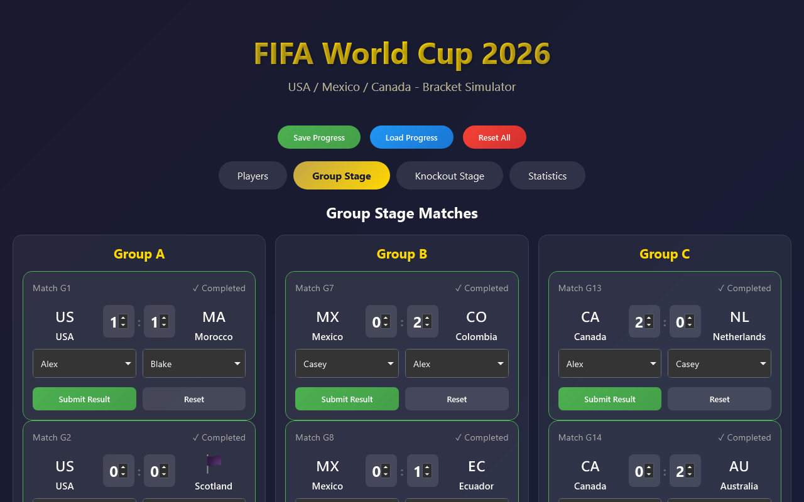
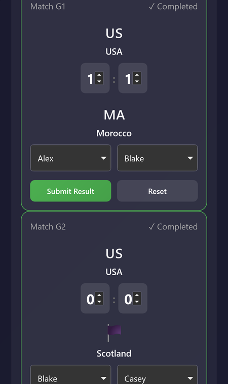
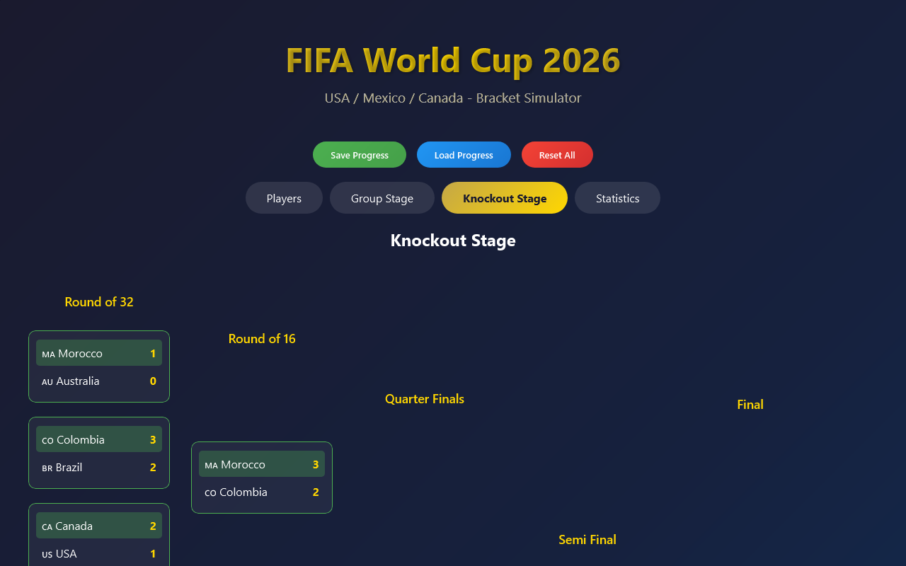
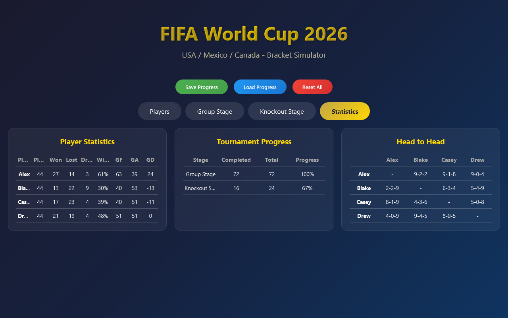

# World Cup 2026 Bracket

A bracket tracker for playing the 2026 World Cup out as FIFA video-game matches with friends: add the players, enter each score, and it builds the standings, the knockout bracket and everyone's head-to-head record.

**[▶ Open the live app](https://timothyhadfield.github.io/world-cup-bracket/)** · works on phone and laptop

  
  &nbsp;
  

  
  &nbsp;
  

*(Screenshots use made-up players.)*

## Features
- **Players**: add everyone who's playing, then pick who controlled each side of every match
- **Group stage**: all 72 group matches across 12 groups; enter a score and the standings update (points, goal difference, goals scored)
- **Knockout bracket**: group winners and runners-up drop into the bracket automatically; tap a match to enter its result and the winner moves on
- **Statistics**: each player's record, win %, goals for and against, tournament progress, and a head-to-head grid
- **Saves on your device**: Save and Load keep the whole tournament in the browser

## Built with
A single HTML file with plain JavaScript and CSS. Progress is stored in the browser's localStorage.
